<!-- OPTIONAL: halftone portrait. Drop your image at assets/portrait.png, then uncomment.

-->
 
<div align="center">

</div>
<samp>
I build high-performance Spigot/Paper Minecraft networks, engineer web applications through SDLC, Agile, AI-SDD and TDD, edit promotional campaigns, and model in Blender.
 
📍 Marilao, Bulacan, Philippines
 
[**mmta.it.com**](https://mmta.it.com) &nbsp;/&nbsp; [github](https://github.com/mmtandico) &nbsp;/&nbsp; [linkedin](https://linkedin.com/in/yourprofile) &nbsp;/&nbsp; [email](mailto:your@email.com)
 
</samp>
<br/>
## `about`
 
```ts
const marco = {
  role        : "Information & Communications Technology specialist",
  based_in    : "Marilao, Bulacan, PH",
  workflow    : ["SDLC", "Agile", "AI Spec-Driven Development", "TDD"],
 
  now         : [
    "Building high-performance Spigot/Paper networks",
    "Shipping web apps with React + TypeScript",
    "Creating 3D models and assets in Blender",
    "Exploring Unreal Engine 5 and multiplayer networking",
  ],
 
  learning    : ["Docker & CI/CD", "Cloud (AWS / Azure)", "WebSockets & real-time apps", "Microservices"],
 
  philosophy  : "Write code that you'd be proud to read 6 months later.",
};
```
 
<br/>
## `services`
 
<table>
  <tr>
    <td width="50%" valign="top">
      <b>Custom Web Application Development</b><br/>
      <sub>End-to-end full-stack apps with React, TypeScript and Node.js. Built for speed, responsiveness and scale.</sub><br/><br/>
      <sub><code>› React / Vite frontends</code><br/>
      <code>› REST &amp; GraphQL endpoints</code><br/>
      <code>› Database design &amp; integration</code><br/>
      <code>› SEO &amp; performance optimization</code></sub>
    </td>
    <td width="50%" valign="top">
      <b>Minecraft Server &amp; Plugin Development</b><br/>
      <sub>Custom Java plugins, Spigot/Paper configuration, economy systems and network setups for SMPs and competitive servers.</sub><br/><br/>
      <sub><code>› Spigot / Paper / Velocity plugins</code><br/>
      <code>› Server configuration &amp; optimization</code><br/>
      <code>› Custom mechanics &amp; mini-games</code><br/>
      <code>› Database &amp; LuckPerms architecture</code></sub>
    </td>
  </tr>
  <tr>
    <td width="50%" valign="top">
      <b>3D Creation &amp; Model Conversion (Blender)</b><br/>
      <sub>Custom 3D models, asset optimization, texture mapping and format conversion for in-game items, cosmetics and web 3D.</sub>
    </td>
    <td width="50%" valign="top">
      <b>UI/UX &amp; Frontend Engineering</b><br/>
      <sub>Designs translated into clean, maintainable code with modern CSS, Framer Motion animations and pixel-perfect layouts.</sub>
    </td>
  </tr>
</table>
<br/>
## `stack`
 
<sub>Programming languages, video editing suites, graphics design software, and 3D modeling tools.</sub>
 
<sub><b>VIDEO EDITING &amp; POST-PRODUCTION</b></sub><br/>
<kbd>Adobe Premiere Pro</kbd> <kbd>DaVinci Resolve</kbd> <kbd>CapCut</kbd> <kbd>Filmora</kbd> <kbd>Promotional Video Editing</kbd> <kbd>Motion Graphics</kbd>
 
<sub><b>ENGINEERING WORKFLOWS &amp; AI METHODOLOGIES</b></sub><br/>
<kbd>SDLC (Software Development Life Cycle)</kbd> <kbd>Agile / Scrum Methodology</kbd> <kbd>AI Spec-Driven Development (SDD)</kbd> <kbd>Test-Driven Development (TDD)</kbd> <kbd>CI/CD Pipelines</kbd> <kbd>AI Agent Harnesses &amp; Prompt Specs</kbd> <kbd>Sprint Planning &amp; Backlog Management</kbd>
 
<sub><b>COMPUTER LANGUAGES &amp; FRAMEWORKS</b></sub><br/>
<kbd>C</kbd> <kbd>C#</kbd> <kbd>Java</kbd> <kbd>HTML5</kbd> <kbd>CSS3</kbd> <kbd>JavaScript</kbd> <kbd>TypeScript</kbd> <kbd>React</kbd> <kbd>Next.js</kbd> <kbd>Flutter</kbd> <kbd>Vite</kbd> <kbd>TailwindCSS</kbd>
 
<sub><b>GRAPHICS, DESIGN &amp; 3D</b></sub><br/>
<kbd>Adobe Photoshop</kbd> <kbd>Photopea</kbd> <kbd>Canva</kbd> <kbd>CorelDraw</kbd> <kbd>Blender 3D</kbd> <kbd>AutoCAD</kbd> <kbd>Technical Drafting</kbd> <kbd>Animation</kbd> <kbd>Figma</kbd>
 
<sub><b>MINECRAFT DEV &amp; SERVER INFRASTRUCTURE</b></sub><br/>
<kbd>Java Plugin Dev</kbd> <kbd>Paper / Spigot API</kbd> <kbd>Velocity Proxy</kbd> <kbd>LuckPerms Architecture</kbd> <kbd>Node.js</kbd> <kbd>Express</kbd> <kbd>REST APIs</kbd>
 
<sub><b>DATABASES &amp; PRODUCTIVITY</b></sub><br/>
<kbd>MySQL</kbd> <kbd>MongoDB</kbd> <kbd>PostgreSQL</kbd> <kbd>SQLite</kbd> <kbd>Redis</kbd> <kbd>MS Office Suite</kbd> <kbd>Google Workspace</kbd>
 
<sub><b>DEVOPS, TOOLS &amp; GAME DEV</b></sub><br/>
<kbd>Git</kbd> <kbd>GitHub</kbd> <kbd>VS Code</kbd> <kbd>Postman</kbd> <kbd>Unreal Engine</kbd> <kbd>C++</kbd> <kbd>UE Blueprints</kbd>
 
<br/>
## `contact`
 
<samp>
Open to collaborations, freelance work and OJT/internship opportunities.
 
[mmta.it.com](https://mmta.it.com) &nbsp;/&nbsp; [email](mailto:your@email.com) &nbsp;/&nbsp; [linkedin](https://linkedin.com/in/yourprofile) &nbsp;/&nbsp; [instagram](https://instagram.com/yourprofile) &nbsp;/&nbsp; [x](https://x.com/yourprofile)
 
</samp>
<br/>
<div align="center">
<sub><samp>"Write code that you'd be proud to read 6 months later."</samp></sub>
 
<br/><br/>
 

 
</div>
 